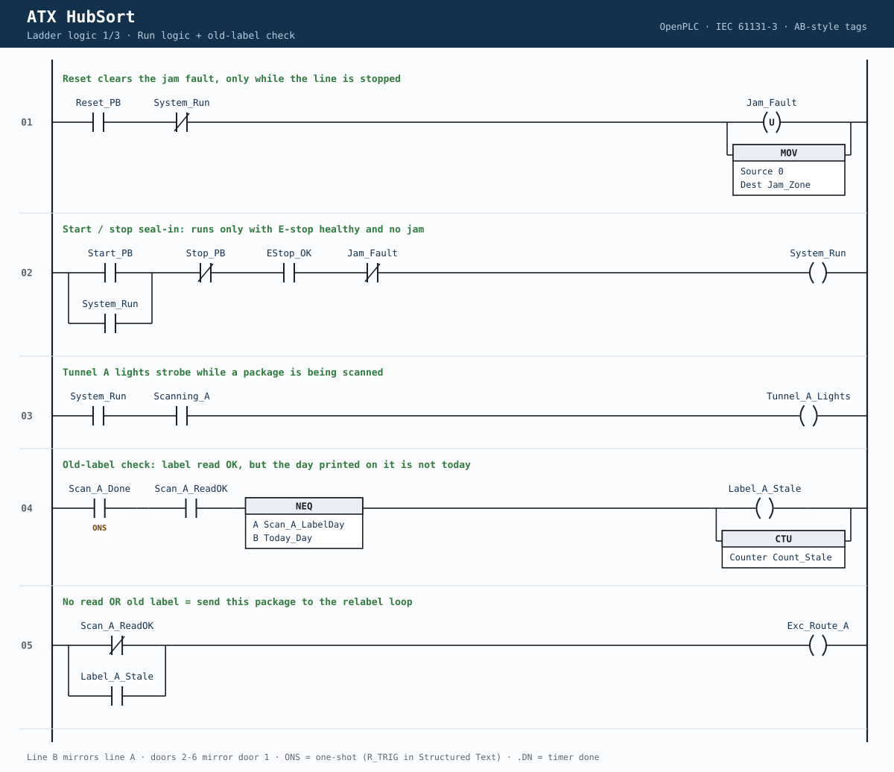
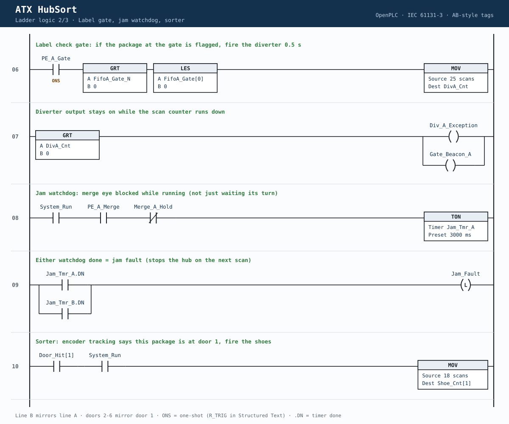
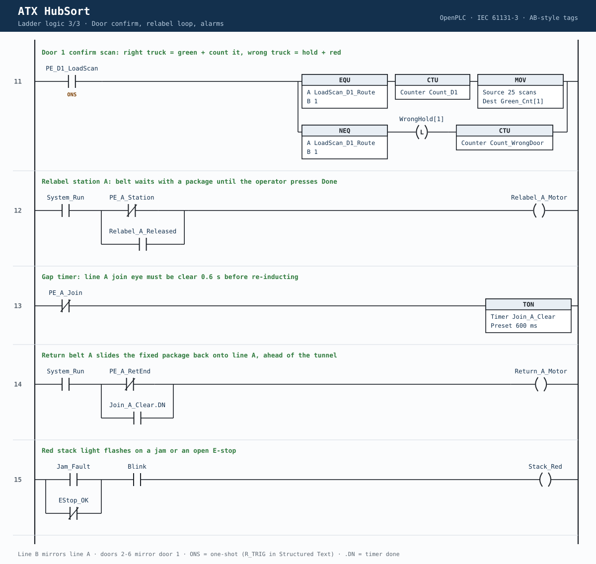

# ATX HubSort

**A parcel hub control system that catches misloads before they reach the truck.**
PLC program (IEC 61131-3 Structured Text + ladder logic) for OpenPLC, a 3D digital twin of the hub, and a tested floor-to-cloud data design.

> I've worked at UPS for 6 years, as a package handler and now a package car driver. One misload I saw over and over: a package still wearing yesterday's routing label. If nobody crosses it out, it rides to the wrong truck. ATX HubSort catches that at the scan tunnel, fixes it, and checks it again, so every package still makes its truck.



---

## What's new in v3 (upgrade of my Scan Tunnel Sorter v2)

| v2 Scan Tunnel Sorter | v3 ATX HubSort |
|---|---|
| 1 induction line, 1 scan tunnel | **2 induction lines, 2 six-sided scan tunnels** |
| Sorted by package size | **Sorted by route** to 6 doors / package cars |
| 4 chutes | **6 doors**, each with its own route color |
| No label check | **Label date check**: old label or no read is pushed off at a gate |
| Exceptions ride off the end | **Relabel loop**: relabel station, return belt, re-induct ahead of the tunnel so it gets **scanned again** |
| One straight line | **Merge** of both lines with **line priority** and a **3 s jam watchdog** (fault, stop, reset) |
| Timed diverts | **Encoder position tracking** (5 cm per pulse) fires the shoes at the right door |
| No check at the truck | **Door confirm scanner**: right truck = green, wrong truck = red hold |
| Start/stop | **E-stop**, seal-in, stack light, fault reset only while stopped |
| Counters only | Counters + status word in **%MW for an edge gateway** (Modbus TCP → MQTT → AWS) |

---

## How a package moves

1. **Trailer unload** onto line A or B
2. **In-motion scale + 6-sided scan tunnel** reads route, label date, size, weight
3. **Label check gate**
   - label read and dated today → rides on
   - old label or no read → diverter pushes it to the **relabel station**
4. **Relabel station** → operator hand-scans, prints a new label, presses Done → **return belt** waits for a 0.6 s gap and slides it back onto its line **before the tunnel**
5. **Merge** onto the shoe sorter (line A has priority; jam watchdog on both merges)
6. **Shoe sorter** tracks each package by encoder and fires the shoes at its door
7. **Door confirm scanner** reads the label one last time before it loads

---

## Ladder logic

The full program is in [`plc/ATX_HubSort.st`](plc/ATX_HubSort.st). These are the key rungs in Allen-Bradley style:

| | |
|---|---|
|  | Rungs 1-5: reset, start/stop seal-in, tunnel lights, **old-label check**, exception routing |
|  | Rungs 6-10: label check gate, diverter, **jam watchdog**, sorter shoe firing |
|  | Rungs 11-15: **door confirm scan**, relabel station, gap timer, return belt, stack light |

Line B mirrors line A. Doors 2-6 mirror door 1.

---

## I/O map

| Inputs | Address | Outputs | Address |
|---|---|---|---|
| Start_PB / Stop_PB / Reset_PB | %IX0.0-0.2 | Conv_A_Motor / Conv_B_Motor | %QX0.0-0.1 |
| EStop_OK | %IX0.3 | Sorter_Motor | %QX0.2 |
| PE_A/B_TunnelEntry | %IX0.4-0.5 | Relabel_A/B_Motor | %QX0.3-0.4 |
| Scan_A/B_Done, Scan_A/B_ReadOK | %IX0.6-1.1 | Return_A/B_Motor | %QX0.5-0.6 |
| PE_A/B_Gate | %IX1.2-1.3 | Tunnel_A/B_Lights | %QX0.7-1.0 |
| PE_A/B_Merge | %IX1.4-1.5 | Div_A/B_Exception | %QX1.1-1.2 |
| PE_Sort_Induct, Enc_Pulse | %IX1.6-1.7 | Shoe_D1-D6 | %QX1.3-2.0 |
| PE_D1-D6_LoadScan | %IX2.0-2.5 | Lamp_Green_D1-D6 | %QX2.1-2.6 |
| PE_A/B_Station, Relabel_A/B_Done_PB | %IX2.6-3.1 | Lamp_Red_D1-D6 | %QX2.7-3.4 |
| PE_A/B_RetEnd, PE_A/B_Join | %IX3.2-3.5 | Stack_Green / Amber / Red | %QX3.5-3.7 |
| Scan_A/B_Route, Scan_A/B_LabelDay | %IW0-3 | Gate_Beacon_A/B | %QX4.0-4.1 |
| Today_Day (from gateway) | %IW4 | | |
| LoadScan_D1-D6_Route | %IW5-10 | | |

**To the edge gateway (%MW):** Count_D1-D6 (%MW0-5), Count_Total, Count_Stale, Count_NoRead, Count_WrongDoor, Count_Relabeled, Count_Reinducted, Count_NoSort (%MW6-12), Status_Word (%MW13), Jam_Zone (%MW14).

---

## Tested

The program compiles with **matiec** (the compiler inside OpenPLC). [`tests/test_hubsort.c`](tests/test_hubsort.c) runs the compiled program with simulated sensors. **30 of 30 checks pass**, including:

- start/stop seal-in, E-stop with no auto-restart
- old label (label day ≠ today) and no-read → diverter fires 0.5 s
- encoder tracking fires the door 1 shoe at exactly 950 cm (190 pulses)
- right truck → green + counted; wrong truck → red flashing hold until pulled
- relabel station waits for the operator; return belt waits for a 0.6 s gap
- merge eye blocked 2.8 s → still running; 3.0 s → jam fault, Start ignored until Reset

```bash
# build matiec (needs flex + bison), then:
iec2c -I matiec/lib plc/ATX_HubSort.st
gcc -w -I. -I matiec/lib/C -o test tests/test_hubsort.c Config0.c Res0.c
./test
```

**Run it in OpenPLC:** open OpenPLC Editor → new project → add a Structured Text program → paste `plc/ATX_HubSort.st` (or upload the file to the OpenPLC Runtime under Programs).

---

## 3D digital twin

[`sim/atx-hubsort-3d.html`](sim/atx-hubsort-3d.html): open it in a browser. A Three.js model of the whole hub runs the same logic: 2 trailers, 2 scan tunnels, label check gates, relabel loop, merge, shoe sorter, 6 color-coded doors and package cars, and the PLC → gateway → cloud data path. Test buttons: **Old label**, **Mis-divert**, **Jam**, and an **Internet link** switch that shows the gateway buffering messages and sending them when the link comes back.

---

## Roadmap

- [x] 3D digital twin + simulation
- [x] PLC program (Structured Text + ladder), compiled and tested
- [ ] Ignition HMI screens over Modbus TCP
- [ ] Python edge gateway (Modbus TCP → MQTT, store-and-forward)
- [ ] AWS IoT Core + Lambda + DynamoDB, built with Terraform
- [ ] Grafana dashboards + Telegram alarms
- [ ] GitHub Actions CI

---

**Built by Cameron Walker** · Austin, TX · demo data and a made-up company name; not affiliated with any carrier.
